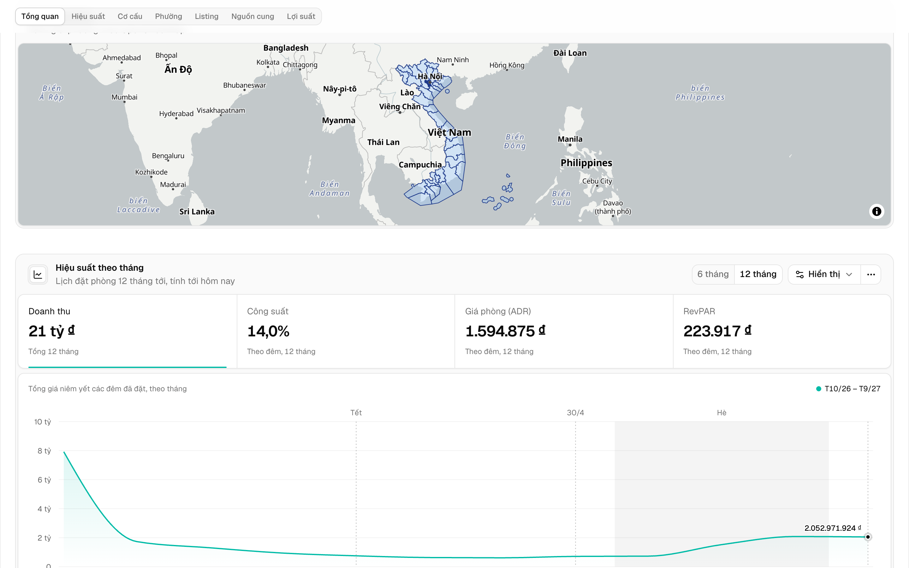
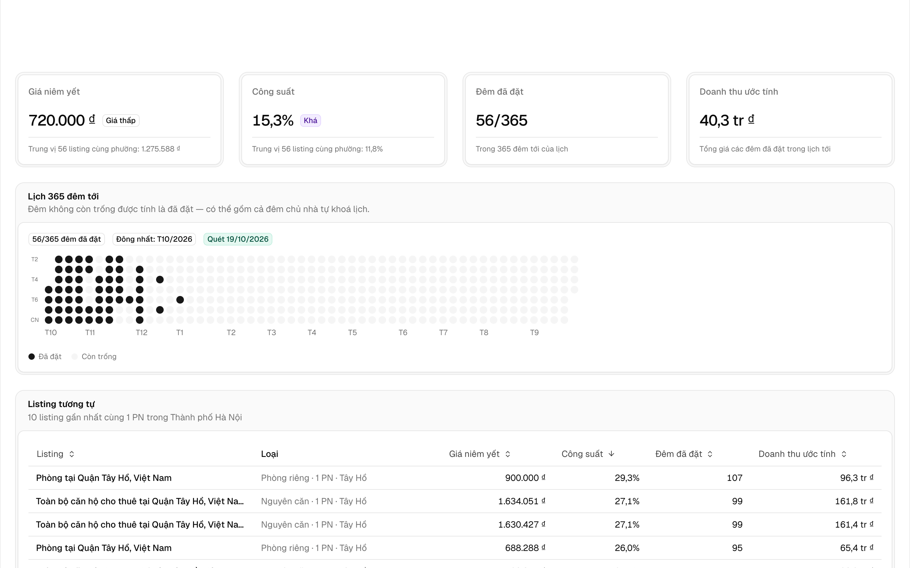
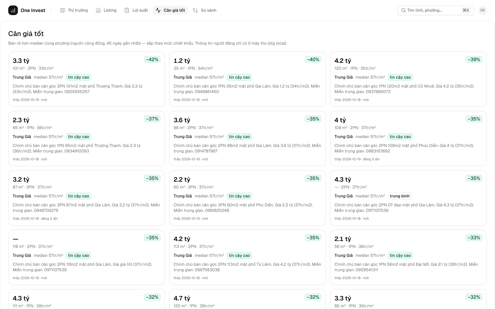

# onehub-invest-app

Real estate investment analytics for Vietnam — market insights, yield calculator, best-value deals.

Built with **Next.js 15** + **React 19** + **Tailwind CSS 4** + **MapLibre GL** + **PostGIS**.





## Features

- 🗺️ **Market Finder** — choropleth map of Vietnam with market scores
- 📊 **Market Insights** — ADR, occupancy, revenue timeseries per market/submarket
- 🏠 **Listing Detail** — photo gallery, availability calendar, comparable listings
- 💰 **Deals** — best-value listings ranked by price/m² vs area median
- 📈 **Yield Calculator** — STR revenue vs long-term rental comparison
- ⚖️ **Compare** — side-by-side market comparison
- 🔐 **Auth** — register/login, saved markets
- 📱 **Responsive** — works on mobile and desktop

## Quick Start

### Prerequisites

- Node.js ≥20
- PostgreSQL with PostGIS (or use [onehub-data-api](https://github.com/phanlemanh/onehub-data-api) with Docker)

### Option 1: With Docker (easiest)

```bash
# Clone both repos
git clone https://github.com/phanlemanh/onehub-data-api.git
git clone https://github.com/phanlemanh/onehub-invest-app.git

# Start database + seed data
cd onehub-data-api
docker compose up -d

# Start the app
cd ../onehub-invest-app
npm install
npm run dev
# Open http://localhost:3000
```

### Option 2: With your own database

```bash
git clone https://github.com/phanlemanh/onehub-invest-app.git
cd onehub-invest-app
npm install

# Create a PostgreSQL database with PostGIS
createdb onehub
psql onehub -c "CREATE EXTENSION IF NOT EXISTS postgis;"

# Apply schema migrations (in order)
for f in db/*.sql; do psql onehub -f "$f"; done

# Seed sample data
psql onehub -f seed.sql

# Create .env.local
echo 'DATABASE_URL=postgres://localhost:5432/onehub' > .env.local

npm run dev
```

## Environment Variables

| Variable | Default | Description |
|---|---|---|
| `DATABASE_URL` | *(required)* | PostgreSQL connection string |
| `NEXT_PUBLIC_MAP_STYLE` | *(optional)* | MapLibre style URL (defaults to OSM) |

## Project Structure

```
src/
├── app/
│   ├── (app)/           # Invest Portal (authenticated)
│   │   ├── [country]/   # Market pages (/vn/hanoi)
│   │   ├── listing/     # Listing detail
│   │   ├── deals/       # Best-value listings
│   │   ├── yield/       # Yield calculator
│   │   └── so-sanh/     # Market comparison
│   ├── (auth)/          # Login/Register
│   ├── (marketing)/     # Public pages
│   └── ops/             # Ops Portal (data quality, coverage)
├── lib/                  # Queries, auth, formatting
├── components/
│   ├── insight/          # Charts, KPI cards, data grids
│   ├── maps/             # MapLibre choropleth
│   ├── shell/            # Layout shells, navigation
│   └── yield/            # Yield calculator UI
└── middleware.ts         # Auth guard
```

## Tech Stack

| Layer | Technology |
|---|---|
| Framework | Next.js 15 (App Router, Server Components) |
| UI | React 19, Tailwind CSS 4, ReUI components |
| Maps | MapLibre GL JS |
| Database | PostgreSQL + PostGIS |
| Auth | Session-based (scrypt hash, httpOnly cookies) |
| Language | TypeScript (strict) |

## Related

- [onehub-data-api](https://github.com/phanlemanh/onehub-data-api) — Standalone REST API for the same data

## Architecture Decisions

See [docs/adr/](docs/adr/) for the full Architecture Decision Records:
- [ADR-0001](docs/adr/0001-initial-stack.md) — Initial stack
- [ADR-0002](docs/adr/0002-market-insights-core.md) — Market Insights as core feature
- [ADR-0003](docs/adr/0003-vn-focus-collector-split.md) — Vietnam focus + collector split
- [ADR-0007](docs/adr/0007-collector-operating-principles.md) — Operating principles (SPL, DQO, DR)

## Contributing

1. Fork the repo
2. Create your feature branch (`git checkout -b feature/amazing`)
3. Commit changes (`git commit -am 'Add amazing feature'`)
4. Push (`git push origin feature/amazing`)
5. Open a Pull Request

## License

[MIT](LICENSE)
